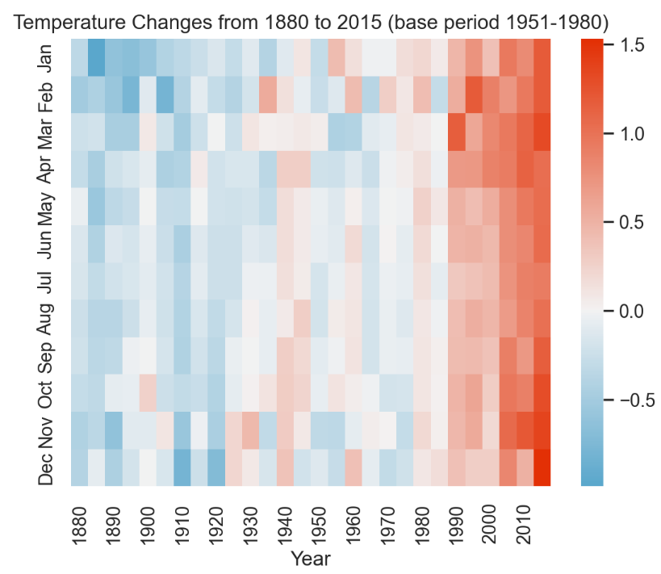

# Northern Hemisphere Temperature Changes Analysis

## The problem or research question
How have surface temperatures changed over time, and are there specific months or seasons experiencing more significant warming between 1880 and 2015?

## Dataset source and usage permissions
The dataset used is `northern_surface_temperature.csv`. It contains historical temperature anomalies based on a 1951-1980 base period.

## Methods and tools used
* **Language:** Python
* **Libraries:** Pandas (for data manipulation), Matplotlib & Seaborn (for data visualization)

## Visualizations
**1. Temperature Anomalies Heatmap (by Month):**

**2. Average Temperature Trend Over Time:**

## Key findings and one limitation
* **Key finding:** Both visualizations clearly show a significant warming trend over the decades. The heatmap reveals that recent years (post-1980s) are notably warmer (red), and the line chart confirms a sharp upward trend in average annual temperature anomalies.
* **Limitation:** This dataset only represents the *Northern Hemisphere* surface temperature and does not account for the entire globe. 

## Instructions for running the analysis
1. Ensure Python 3 is installed.
2. Install the required libraries: `pip install pandas numpy matplotlib seaborn`.
3. Place the dataset `northern_surface_temperature.csv` in the same directory as the notebook.
4. Run the Jupyter Notebook to reproduce the visualizations.
